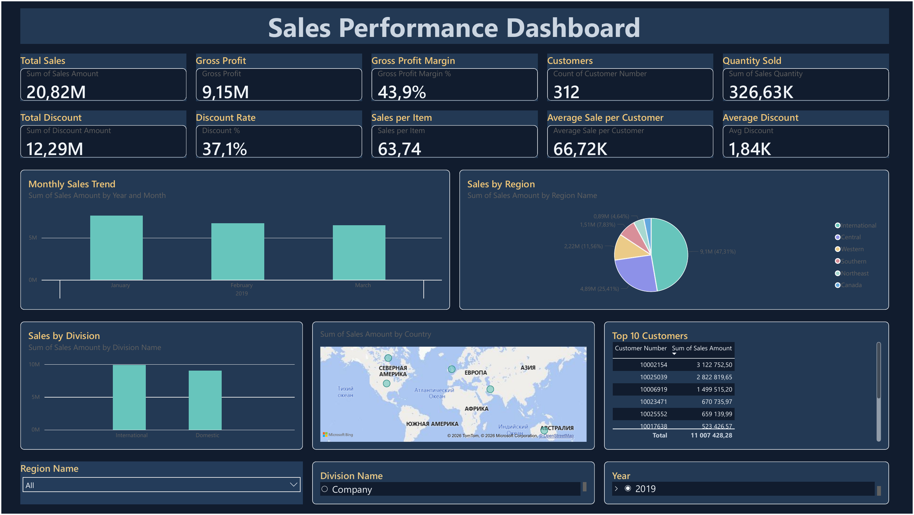

Sales Performance Dashboard | Power BI

## Dashboard Preview

Project Overview

An interactive Power BI dashboard designed to explore sales performance, profitability, customer activity, and regional sales distribution.

The project demonstrates how transactional sales data can be transformed into business insights through KPI monitoring, interactive filtering, and data visualization.

Business Objectives

* Monitor overall sales and gross profit.
* Evaluate profitability and discount performance.
* Identify sales trends over time.
* Compare performance across geographic regions and business divisions.
* Explore customer-level sales contributions.

Key Performance Indicators

The dashboard includes 10 KPI cards:

KPI	Description
Total Sales	Total recorded sales amount
Gross Profit	Total gross profit
Gross Profit Margin	Profitability as a percentage of sales
Customers	Number of distinct customers
Quantity Sold	Total quantity of items sold
Total Discount	Total discount amount
Discount Rate	Discount percentage
Sales per Item	Average sales amount per item
Average Sale per Customer	Average sales amount per customer
Average Discount	Average discount value

Dashboard Features

* Monthly sales trend analysis
* Sales distribution by region
* Sales comparison by business division
* Geographic sales visualization
* Top 10 customers by sales amount
* Interactive filters for region, division, and year

Tools & Technologies

* Power BI Desktop — dashboard development and visualization
* Power Query — data preparation and transformation
* DAX — KPI calculations and analytical measures
* GitHub — project documentation and version control

Dataset

The dashboard uses a sales dataset containing transaction, customer, product, geographic, and business division information.

The project is presented as a portfolio demonstration of business intelligence and sales analytics techniques.

Business Value

This dashboard illustrates how sales reporting can help businesses monitor commercial performance, identify differences between markets, assess profitability, and support data-driven decision-making.

Author

Anton Shuleshov

Marketing & Business Analytics Professional | Transitioning into Data Analytics & Business Intelligence
## Data Source & Dataset

This portfolio project analyzes a structured sales dataset containing transactional, customer, product, division, geographic, and time-related information. The dashboard uses sales, discount, profit, quantity, and customer metrics to support business performance analysis.

Dataset provenance: To be confirmed. The dashboard is presented as a portfolio exercise and does not represent verified financial results of a named company.

## Business Insights

The dashboard enables users to:
- Monitor revenue, gross profit, and gross profit margin.
- Compare sales performance across regions and business divisions.
- Examine monthly sales trends and identify changes over time.
- Analyze customer contributions and the top 10 customers by sales.
- Explore discounts and their relationship with profitability.

Example dashboard view (2018, Company division):
- Total Sales: 164.89M
- Gross Profit: 68.17M
- Gross Profit Margin: 41.3%
- Customers: 540
- Discount Rate: 39.7%

These figures reflect the selected filters and are not overall dataset totals.

## Data Model & Analytical Measures

The Power BI report uses multiple related data tables, including customer, division, region, and sales-related information. It combines interactive visuals, KPI cards, geographic analysis, and report-level filtering.

Measures displayed in the dashboard include:
- Total Sales
- Gross Profit
- Gross Profit Margin (%)
- Total Discount
- Discount Rate (%)
- Sales per Item
- Average Sales per Customer
- Average Discount

The report demonstrates Power BI data modeling, business metric interpretation, and interactive dashboard design. Specific DAX expressions and relationships can be documented separately after verification in the source Power BI project
