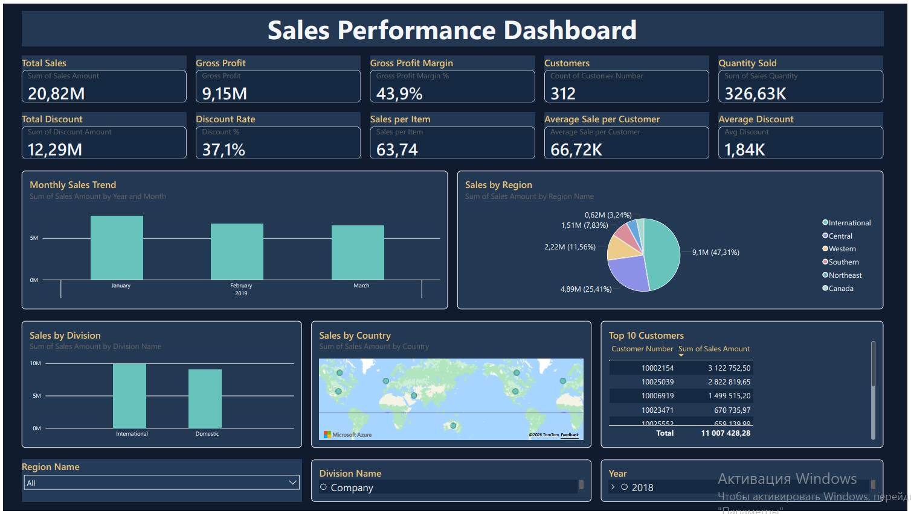

# Sales Performance Dashboard | Business Intelligence & Data Analytics

### Power BI · Power Query · DAX · Data Modeling · Commercial Performance

An end-to-end business intelligence project transforming sales transactions and related customer reference tables into an interactive management dashboard. The report combines **data preparation, relationship modeling, KPI validation, and business-oriented visual analysis**—not just chart creation.

> **Project type:** Educational data analytics portfolio project  
> **Author:** Anton Shuleshov  
> **Primary tools:** Microsoft Power BI Desktop, Power Query (M), DAX, Microsoft Excel

## Business problem

How can sales managers monitor revenue and profitability, evaluate discounting, identify important customers, and compare performance across time, regions and business divisions?

## Analytical workflow

| Stage | Implementation | Demonstrated skill |
| --- | --- | --- |
| Data acquisition | Import five related Excel datasets | Multi-source data integration |
| Data profiling | Inspect types, missing values and inconsistent dates | Data-quality assessment |
| Data preparation | Transform sales and lookup tables using Power Query | ETL / data cleaning |
| Data validation | Correct a margin field incorrectly typed as a date; handle Excel date representations and missing delivery dates | Troubleshooting and quality controls |
| Data modeling | Relate transactions, customers, addresses, regions and divisions using business keys | Relational modeling, filter context |
| KPI calculations | Calculate and aggregate sales, gross profit, margins, discounts and customer metrics | DAX, business metric definitions |
| Analysis | Compare monthly trends, regions, divisions and major customers | Exploratory and commercial analytics |
| Delivery | Build interactive visuals and slicers; export PBIX and PDF | BI reporting and data storytelling |

## Data sources and relationships

| Table | Purpose |
| --- | --- |
| `SALESDATA` (sales fact table / `Sheet1` in the model) | Sales transactions, quantities, values and dates |
| `CUSTOMERS` | Customer-level attributes and business keys |
| `CUSTOMERADDRESS` | Geographic customer information |
| `REGION` | Region lookup |
| `DIVISION` | Division lookup |

The model uses customer and lookup identifiers to connect transactional and descriptive data. Relationships and aggregation behavior should be reviewed when adapting the model to new data.

## Dashboard KPIs

- Total Sales
- Gross Profit
- Gross Profit Margin
- Customers
- Quantity Sold
- Total Discount
- Discount Rate
- Sales per Item
- Average Sale per Customer
- Average Discount

## Dashboard analysis

- **Monthly Sales Trend:** sales performance over time.
- **Sales by Region:** geographic business comparisons.
- **Sales by Division:** performance across organizational units.
- **Top 10 Customers:** customer contribution and concentration.
- **Sales by Country:** geographic context; map-service rendering may vary by client and locale.
- **Interactive filters:** region, division and year.

## Technical competencies

**Power Query / ETL:** import, type conversion, date handling, data cleanup and troubleshooting.  
**Data modeling:** multi-table relationships, fact and lookup tables, aggregation logic.  
**DAX:** measures for financial, sales and customer performance indicators.  
**Business intelligence:** KPI selection, performance comparison, interactive reporting and presentation.

This repository does **not** claim SQL, Hive, Pig or R were used to produce this particular dashboard. Those technologies are documented in the relevant projects and coursework.

## Repository files

- `Sales_Perfomance_Portfolio.pbix` — interactive Power BI report.
- `Sales_Perfomance_Portfolio.pdf` — static report.
- `dashbord.png` — dashboard screenshot (original filename retained for compatibility).
- `Data/` — educational source spreadsheets.
- PBIP source files, where included, contain the editable report and semantic model definitions.

## Reproduce or adapt

1. Download the PBIX or the complete PBIP project and its report/model folders.
2. Open in a recent version of Power BI Desktop.
3. If refreshing, update Excel source paths in **Transform data → Data source settings** to the location of the files in `Data/`.
4. Refresh, review model relationships and validate KPIs against the source data.
5. Use slicers to explore results by business unit, geography and year.

## Scope and interpretation

This is an educational portfolio dataset, not a live operational reporting system. Values depend on source data and filter context. Business conclusions should be interpreted within those constraints.

---

**Anton Shuleshov** · Business & Data Analytics · Power BI / Data Modeling / ETL

